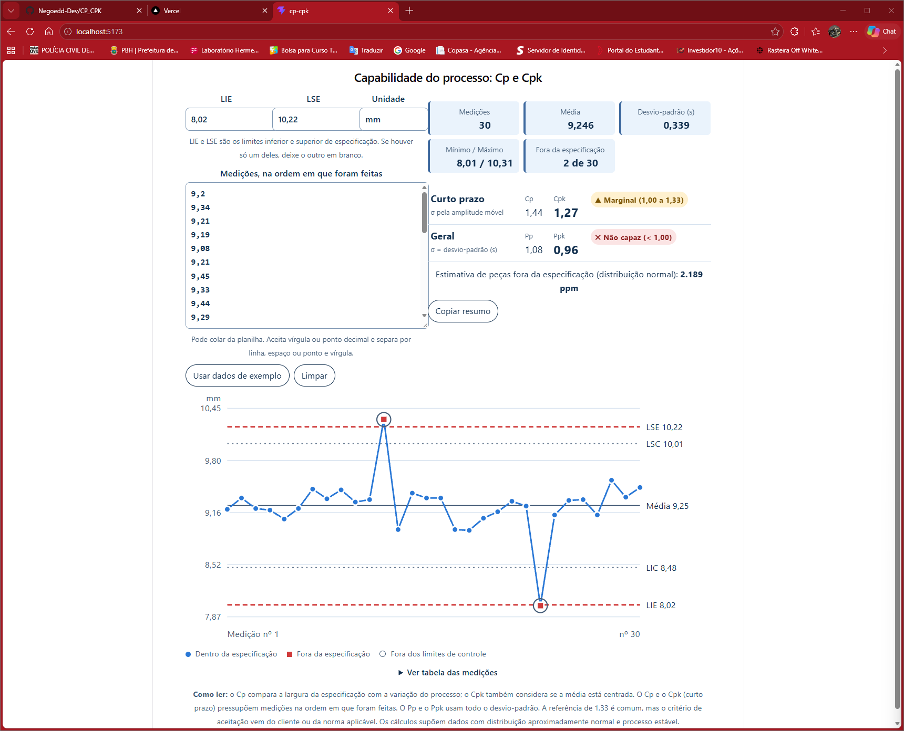

# Cp e Cpk com carta de controle

Calcula os índices de capabilidade de um processo a partir de medições e desenha a carta de valores individuais, com limites de especificação e de controle.



**Demo:** _(https://cp-cpk-five.vercel.app/)_

## Por que criei

Na inspeção de qualidade em siderurgia, as medições de um lote só dizem alguma coisa quando comparadas com a especificação e com a variação do processo. Criei esta ferramenta para ver isso de forma rápida e visual. Também faz parte dos meus estudos de desenvolvimento web com React.

## O que ele faz

- Entrada das medições e dos limites de especificação (LIE e LSE).
- Cp, Cpk, Pp e Ppk.
- Estimativa de ppm fora da especificação.
- Carta de valores individuais (SVG) com os limites de controle.

## Como calcula

```
Cp  = (LSE − LIE) / 6σ
Cpk = min((LSE − μ) / 3σ, (μ − LIE) / 3σ)
σ (curto prazo) = MR̄ / 1,128      (MR̄: média das amplitudes móveis)
Pp, Ppk: mesma forma, usando o desvio padrão amostral (s)
Limites de controle: μ ± 2,66 · MR̄
```

A estimativa de ppm usa a distribuição normal.

## Tecnologias

React, Vite, JavaScript, CSS, SVG.

## Como rodar

Requisito: [Node.js](https://nodejs.org) 18 ou superior.

```bash
git clone https://github.com/Negoedd-Dev/cp-cpk
cd cp-cpk
npm install
npm run dev
```

Abra o endereço que aparecer no terminal (normalmente http://localhost:5173).
Sem o Git, baixe o ZIP pelo botão verde **Code** desta página.

## Observações

- Os índices assumem dados aproximadamente normais e processo estável. Confira a carta de controle antes de confiar no resultado.
- Quanto mais medições, mais confiável a estimativa. Com poucas amostras, trate o número como indicativo.
- Os dados de exemplo são fictícios.

## Autor

Negoedd · [LinkedIn](https://www.linkedin.com/in/edson-nunes)
